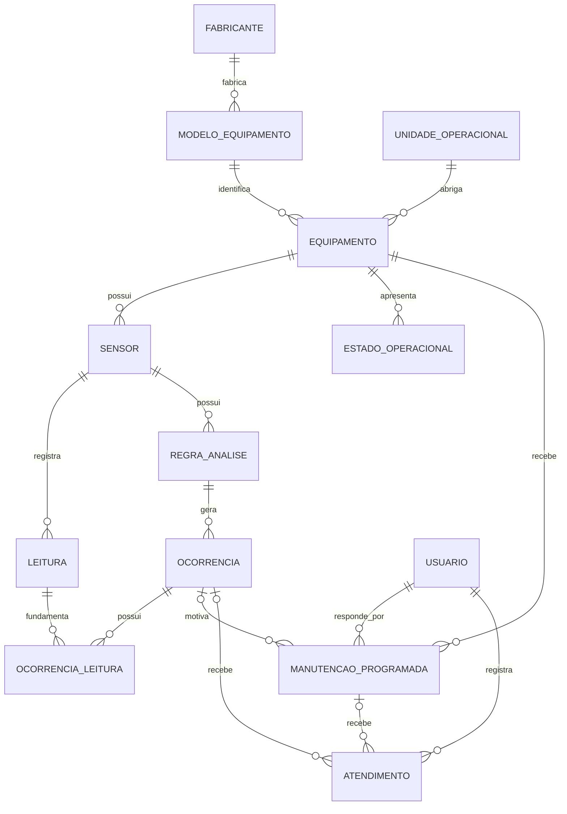

# Modelo de dados inicial do Monitoramento Prisma

O MVP acompanha bombas de transferência entre tanques em uma unidade fictícia de óleo e gás. O simulador envia medições por sensor e mudanças de estado operacional em JSON. A aplicação usa esses dados para detectar desvios, explicar sua prioridade, sugerir verificações e registrar o atendimento.

## Diagrama entidade-relacionamento

## Dicionário de dados

Os tipos abaixo são propostos para PostgreSQL. PK indica chave primária e FK indica chave estrangeira. Os campos são obrigatórios, salvo quando indicados como opcionais.

| Entidade | Campos principais |
| --- | --- |
| Unidade operacional | `id` (bigint, PK), `nome` (text) |
| Equipamento | `id` (bigint, PK), `unidade_id` (FK), `codigo`, `nome`, `localizacao` e `criticidade` (text). O código é único na unidade. O cadastro representa a bomba. |
| Sensor | `id` (bigint, PK), `equipamento_id` (FK), `id_sensor_origem` (text, único), `grandeza`, `unidade_medida` e `ponto_medicao` (text) |
| Leitura | `id` (bigint, PK), `sensor_id` (FK), `id_leitura_origem` (text), `medida_em` e `recebida_em` (timestamptz), `valor` (numeric), `unidade_medida`, `qualidade_origem` e `resultado_validacao` (text) |
| Estado operacional | `id` (bigint, PK), `equipamento_id` (FK), `estado` (text), `inicio_em` e `fim_em` (timestamptz). O fim é opcional para o estado vigente. |
| Manutenção programada | `id` (bigint, PK), `equipamento_id` (FK), `inicio_previsto` e `fim_previsto` (timestamptz), `descricao` (text) |
| Regra de análise | `id` (bigint, PK), `equipamento_id` (FK), `sensor_id` (FK opcional para regras do equipamento), `nome`, `tipo`, `estado_aplicavel` (opcional), `prioridade_base` e `verificacao_sugerida` (text), `limite_inferior` e `limite_superior` (numeric, conforme o tipo), `duracao_minima_segundos` (integer), `ativa` (boolean) |
| Ocorrência | `id` (bigint, PK), `regra_id` (FK), `inicio_desvio_em` e `detectada_em` (timestamptz), `situacao`, `prioridade`, `justificativa` e `verificacao_sugerida` (text), `contexto_deteccao` (jsonb) |
| Ocorrência–leitura | `ocorrencia_id` e `leitura_id` (FKs e PK composta) |
| Usuário | `id` (bigint, PK), `nome` e `email` (text). O e-mail identifica unicamente o usuário. |
| Atendimento | `id` (bigint, PK), `ocorrencia_id` e `usuario_id` (FKs), `registrado_em` (timestamptz), `descricao` (text), `situacao_anterior` e `situacao_nova` (text, ambas opcionais para registros sem mudança de situação) |

## Telemetria e análise

- Cada mensagem de medição contém `id_leitura_origem`, `id_sensor_origem`, `data_hora_medicao`, `valor`, `unidade_medida` e `qualidade`. A API identifica o sensor cadastrado e acrescenta o horário de recebimento e o resultado da validação. O par `(sensor_id, id_leitura_origem)` é único para reconhecer reenvios. O histórico por sensor usa o horário da medição.
- As unidades propostas para a simulação são m³/h para vazão, bar para pressão de entrada e saída, °C para temperatura e mm/s para velocidade de vibração RMS. O cadastro do sensor informa o ponto monitorado e, para vibração, a direção. A qualidade de origem pode ser válida, incerta ou inválida.
- Os eventos de estado da bomba são independentes das medições. Os estados iniciais propostos são ligada, desligada, em partida e em manutenção. Para cada equipamento, os períodos de estado não se sobrepõem. A análise usa o estado vigente no instante da medição. Uma janela de manutenção programada indica o planejamento e pode servir de contexto para a regra.
- Uma regra vinculada a um sensor usa um sensor do mesmo equipamento. Uma ocorrência pode apontar para várias leituras de evidência. A ausência de leituras pode gerar ocorrência sem leitura associada, por meio de uma verificação periódica. O contexto da detecção guarda os fatores usados na decisão, como limites efetivos, estado da bomba e janela observada. A prioridade, a justificativa e a sugestão são salvas com a ocorrência para preservar o que foi apresentado ao gestor.
- O fluxo inicial proposto é **aberta → em atendimento → encerrada**. Uma alteração de situação atualiza a ocorrência e grava o histórico do atendimento na mesma transação.

## Exemplo de ponta a ponta

O simulador envia leituras válidas do sensor de vazão de uma bomba ligada. Se a vazão permanecer abaixo da faixa configurada pelo tempo exigido pela regra, o sistema abre uma ocorrência e vincula as leituras usadas como evidência. O gestor vê a prioridade atribuída, a justificativa e uma sugestão de conferir a indicação do sensor. Quando alguém registra a verificação realizada, o atendimento fica associado à ocorrência e ao usuário responsável.

## Decisões em aberto

- Limites de referência, durações, frequência de envio e cálculo da prioridade para cada cenário simulado.
- Tratamento de medições atrasadas, qualidade incerta e manutenção programada na avaliação das regras.
- Critério para agrupar desvios consecutivos em uma ocorrência e para abrir uma nova após a recuperação.
- Contrato do evento de estado, autenticação, perfis de acesso e eventual importação de CSV.
