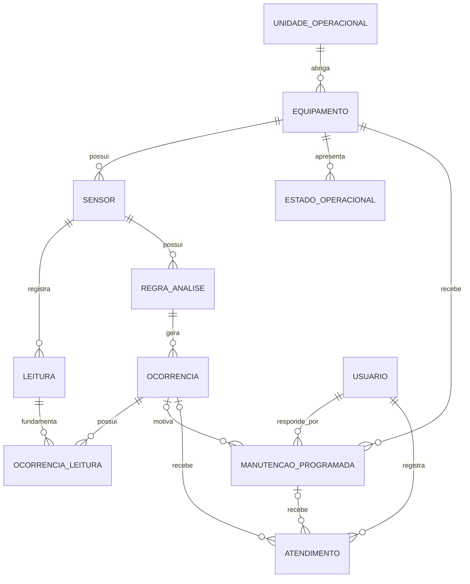
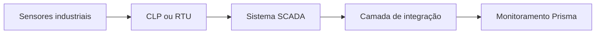
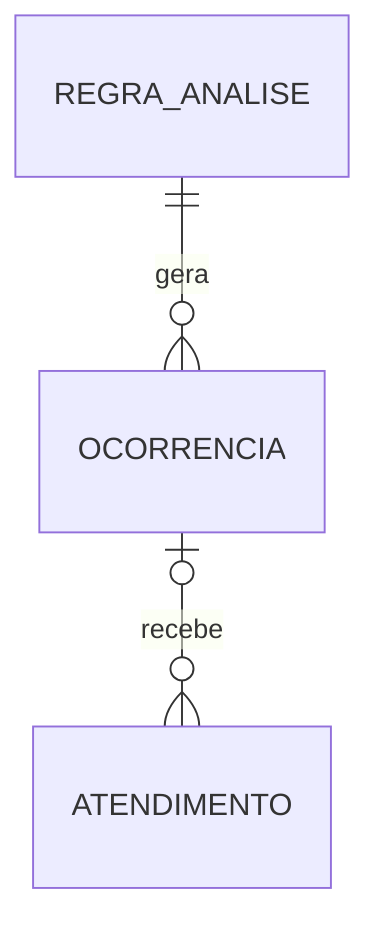

# Modelo de dados inicial do Monitoramento Prisma

O MVP acompanha bombas de transferência entre tanques em uma unidade fictícia de óleo e gás. O sistema atua como uma camada complementar de análise de dados provenientes de sistemas de supervisão industrial, como o SCADA (Supervisory Control and Data Acquisition).

Para fins de desenvolvimento e validação do MVP, um simulador representa uma fonte externa de dados industriais, disponibilizando medições e mudanças de estado operacional em JSON.

A aplicação recebe, valida, armazena e analisa esses dados para detectar desvios operacionais, atribuir prioridades, apresentar evidências, sugerir verificações e registrar as providências tomadas pelos profissionais responsáveis.

## Diagrama entidade-relacionamento



## Dicionário de dados

Os tipos abaixo são propostos para PostgreSQL. PK indica chave primária e FK indica chave estrangeira. Todas as chaves estrangeiras utilizam o tipo bigint. Os campos são obrigatórios, salvo quando indicados como opcionais.

| Entidade | Campos principais |
| --- | --- |
| Unidade operacional | `id` (bigint, PK), `nome` (text) |
| Equipamento | `id` (bigint, PK), `unidade_id` (FK), `codigo`, `nome`, `fabricante`, `marca`, `modelo`, `numero_serie`, `localizacao` e `criticidade` (text). O código é único dentro da unidade operacional. |
| Sensor | `id` (bigint, PK), `equipamento_id` (FK), `tag_origem` (text, único), `grandeza`, `unidade_medida` e `ponto_medicao` (text) |
| Leitura | `id` (bigint, PK), `sensor_id` (FK), `id_leitura_origem` (text), `medida_em` e `recebida_em` (timestamptz), `valor` (numeric), `unidade_medida`, `qualidade_origem` e `resultado_validacao` (text) |
| Estado operacional | `id` (bigint, PK), `equipamento_id` (FK), `estado` (text), `inicio_em` e `fim_em` (timestamptz). O fim é opcional para o estado vigente. |
| Manutenção programada | `id` (bigint, PK), `equipamento_id` (FK), `responsavel_id` (FK para usuário), `ocorrencia_id` (FK opcional), `titulo`, `descricao`, `tipo` e `situacao` (text), `inicio_previsto`, `fim_previsto`, `inicio_real` (opcional) e `fim_real` (opcional) (timestamptz) |
| Regra de análise | `id` (bigint, PK), `sensor_id` (FK), `nome`, `operador`, `estado_aplicavel` (opcional), `prioridade_base` e `verificacao_sugerida` (text), `valor_referencia` (numeric), `duracao_minima_segundos` (integer), `ativa` (boolean) |
| Ocorrência | `id` (bigint, PK), `regra_id` (FK), `inicio_desvio_em` e `detectada_em` (timestamptz), `situacao`, `prioridade`, `justificativa` e `verificacao_sugerida` (text), `contexto_deteccao` (jsonb) |
| Ocorrência–leitura | `ocorrencia_id` e `leitura_id` (FKs e PK composta) |
| Usuário | `id` (bigint, PK), `nome`, `email` (único), `senha_hash`, `matricula` (única), `cargo` e `perfil` (text), `ativo` (boolean), `criado_em` (timestamptz) |
| Atendimento | `id` (bigint, PK), `ocorrencia_id` (FK opcional), `manutencao_id` (FK opcional), `usuario_id` (FK), `tipo_acao` e `descricao` (text), `registrado_em` (timestamptz), `situacao_anterior` e `situacao_nova` (text, ambas opcionais para registros sem mudança de situação) |

## Integração com sistemas industriais

Em ambientes industriais, os sensores podem utilizar sinais analógicos ou digitais para transmitir medições a controladores, como CLPs (Controladores Lógicos Programáveis) e RTUs (Unidades Terminais Remotas).

Esses controladores podem disponibilizar informações para sistemas de supervisão industrial, utilizando protocolos como Modbus e OPC UA.

O Monitoramento Prisma não será responsável pela aquisição direta dos sinais físicos dos sensores nem pelo controle dos equipamentos. Sua responsabilidade será receber e analisar dados disponibilizados por uma camada de integração com os sistemas industriais existentes.



No MVP, o simulador representa a fonte externa de dados disponibilizados pela camada de integração. O JSON será utilizado como formato de comunicação com a API do Prisma, não necessariamente como formato nativo de transmissão dos sensores industriais.

## Telemetria e validação

Cada mensagem de medição contém:

- `id_leitura_origem`: identificador da medição no sistema de origem.
- `tag_origem`: identificação da variável monitorada no sistema industrial.
- `data_hora_medicao`: instante em que a medição foi realizada.
- `valor`: valor numérico medido.
- `unidade_medida`: unidade utilizada na medição.
- `qualidade`: indicação da qualidade do dado fornecida pela origem.

Exemplo de mensagem:

```json
{
  "id_leitura_origem": "MED-000145",
  "tag_origem": "B01.TEMP.MANCAL",
  "data_hora_medicao": "2026-11-25T13:30:00-03:00",
  "valor": 85.5,
  "unidade_medida": "°C",
  "qualidade": "valida"
}
```

A API identifica o sensor cadastrado por meio da tag de origem e acrescenta o horário de recebimento e o resultado da validação.

O par `(sensor_id, id_leitura_origem)` é único, permitindo identificar reenvios e evitar a duplicação de medições.

O histórico das leituras utiliza o horário da medição como referência temporal.

### Grandezas monitoradas

| Grandeza | Unidade de medida | Exemplo de tag |
| --- | --- | --- |
| Vazão | m³/h | `B01.VAZAO` |
| Pressão de entrada | bar | `B01.PRESS.ENTRADA` |
| Pressão de saída | bar | `B01.PRESS.SAIDA` |
| Temperatura | °C | `B01.TEMP.MANCAL` |
| Velocidade de vibração RMS | mm/s | `B01.VIBRACAO.RADIAL` |

O cadastro do sensor representa o ponto de medição associado ao equipamento e informa a grandeza monitorada, a unidade esperada e o ponto de medição.

### Qualidade e validação dos dados

A qualidade de origem representa a informação fornecida pelo sistema externo sobre a confiabilidade da medição. Os valores inicialmente previstos são:

- `valida`;
- `incerta`;
- `invalida`.

O resultado da validação representa a avaliação realizada pelo backend do Prisma, considerando a compatibilidade da unidade de medida, a qualidade informada pela origem e a consistência dos dados recebidos.

Uma leitura pode ser considerada válida pela origem e, ainda assim, apresentar incompatibilidades com o cadastro do sensor.

A validação dos dados é independente da análise operacional. Uma medição válida pode representar um desvio operacional.

Inicialmente, somente leituras aceitas pela validação serão utilizadas pelo mecanismo de análise.

Mensagens sem identificação de sensor cadastrado ou sem os campos obrigatórios serão rejeitadas pela API.

## Estado operacional

Os eventos de estado operacional da bomba são independentes das medições dos sensores.

Os estados inicialmente previstos são:

- Ligada;
- Desligada;
- Em partida;
- Em manutenção.

A entidade `ESTADO_OPERACIONAL` preserva o histórico das condições de funcionamento do equipamento.

Para cada equipamento, os períodos de estado operacional não podem se sobrepor. Um registro sem horário de término representa o estado vigente.

A análise utiliza o estado operacional correspondente ao instante da medição, permitindo contextualizar os dados e reduzir a geração de falsos alertas.

Por exemplo, uma vazão igual a zero pode representar uma condição normal para uma bomba desligada, mas um possível desvio para uma bomba ligada.

O estado operacional representa a condição efetiva do equipamento, enquanto a manutenção programada representa o planejamento de uma intervenção.

## Regras de análise

Cada regra de análise está obrigatoriamente vinculada a um sensor específico.

O equipamento ao qual a regra se aplica é identificado indiretamente por meio do relacionamento entre sensor e equipamento, evitando a duplicação dessa referência.

Uma regra define uma condição de comparação entre o valor medido e um valor de referência.

Os operadores inicialmente previstos são:

- `>`: maior que;
- `<`: menor que;
- `>=`: maior ou igual;
- `<=`: menor ou igual.

O atributo `valor_referencia` utiliza a unidade de medida cadastrada no sensor.

O atributo `duracao_minima_segundos` determina por quanto tempo a condição de desvio precisa ser observada antes da geração de uma ocorrência. O valor zero permite a detecção imediata.

O atributo `estado_aplicavel` determina em qual estado operacional a regra deve ser executada. Quando não informado, a regra pode ser aplicada independentemente do estado operacional.

O atributo `prioridade_base` representa a classificação inicialmente atribuída ao desvio, podendo assumir os valores baixa, média, alta ou crítica.

O atributo `ativa` permite habilitar ou desabilitar uma regra sem excluir seu cadastro e comprometer o histórico das ocorrências.

### Exemplos de regras

| Regra | Sensor | Operador | Valor de referência | Duração mínima | Estado aplicável | Prioridade base |
| --- | --- | --- | --- | --- | --- | --- |
| Temperatura elevada | Temperatura | `>` | 85 °C | 30 s | Ligada | Alta |
| Vazão insuficiente | Vazão | `<` | 40 m³/h | 30 s | Ligada | Média |
| Pressão insuficiente | Pressão de entrada | `<` | 2 bar | 60 s | Ligada | Alta |
| Pressão elevada | Pressão de saída | `>` | 6 bar | 10 s | Ligada | Alta |
| Vibração excessiva | Vibração | `>` | 7 mm/s | 30 s | Ligada | Alta |

Os valores apresentados são fictícios e destinados exclusivamente à simulação. Limites operacionais reais dependem das características dos equipamentos e das recomendações técnicas aplicáveis.

Para identificar valores fora de uma faixa aceitável, podem ser cadastradas duas regras independentes para o mesmo sensor: uma para o limite inferior e outra para o limite superior.

Essa abordagem permite atribuir prioridades e verificações sugeridas diferentes para cada condição de desvio.

O MVP contempla regras de comparação individual por sensor. Análises envolvendo múltiplos sensores, ausência de dados e modelos preditivos poderão ser incorporadas posteriormente.

## Ocorrências e evidências

Uma ocorrência representa um desvio operacional identificado pelo mecanismo de análise.

Cada ocorrência está associada à regra responsável pela sua geração.

Uma mesma regra pode gerar diferentes ocorrências ao longo do tempo, e uma ocorrência pode ser fundamentada por diversas leituras.

A entidade associativa `OCORRENCIA_LEITURA` resolve o relacionamento N:N entre ocorrências e leituras, permitindo que:

- Uma ocorrência possua várias leituras como evidência.
- Uma leitura seja utilizada como evidência de diferentes ocorrências.

As leituras vinculadas devem pertencer ao sensor associado à regra que originou a ocorrência.

O contexto da detecção, armazenado em JSONB, preserva os fatores considerados pelo mecanismo de análise, como:

- Operador de comparação utilizado;
- Valor de referência aplicado;
- Duração mínima configurada;
- Estado operacional do equipamento;
- Intervalo temporal analisado;
- Criticidade do equipamento, quando considerada no cálculo da prioridade.

A prioridade, a justificativa e a verificação sugerida são armazenadas diretamente na ocorrência para preservar as informações apresentadas ao gestor no momento da detecção, mesmo que a regra seja modificada posteriormente.

O fluxo inicial de situação das ocorrências é:

**Aberta → Em atendimento → Encerrada.**

## Manutenção programada

A entidade `MANUTENCAO_PROGRAMADA` representa intervenções planejadas sobre os equipamentos monitorados.

Uma manutenção pode ser programada independentemente da existência de uma ocorrência ou ser motivada por um desvio identificado pelo sistema.

Os tipos inicialmente previstos são:

- Preventiva;
- Corretiva.

Cada manutenção está vinculada obrigatoriamente a um equipamento e a um usuário responsável.

O relacionamento com a ocorrência é opcional, pois uma manutenção preventiva, por exemplo, pode ser programada sem que exista um desvio operacional identificado.

Quando vinculada a uma ocorrência, a manutenção deve pertencer ao mesmo equipamento monitorado pela regra que originou o desvio.

Os atributos `inicio_previsto` e `fim_previsto` representam o período planejado da intervenção, enquanto `inicio_real` e `fim_real` representam o período efetivo de execução.

O fluxo inicial de situação das manutenções é:

**Programada → Em execução → Concluída.**

Uma manutenção também pode assumir a situação cancelada.

O responsável cadastrado representa o profissional designado para acompanhar ou executar a intervenção. Os profissionais que efetivamente registrarem ações serão identificados por meio dos atendimentos.

O MVP considera um responsável principal por manutenção, sem gerenciamento de equipes, estoque de peças ou ordens de serviço complexas.

## Usuários e controle de acesso

A entidade `USUARIO` representa os profissionais autorizados a utilizar o sistema.

O cadastro contempla informações de identificação pessoal, identificação profissional, autenticação e controle de acesso.

O e-mail e a matrícula são identificadores únicos.

A senha não será armazenada em texto puro. O atributo `senha_hash` armazenará exclusivamente o hash da senha, produzido por um algoritmo apropriado para armazenamento de credenciais.

O atributo `cargo` representa a função profissional exercida pelo usuário, enquanto `perfil` determina suas permissões dentro da aplicação.

Os perfis inicialmente propostos são:

| Perfil | Responsabilidade |
| --- | --- |
| Administrador | Gerenciar usuários, cadastros e configurações do sistema. |
| Gestor | Acompanhar ocorrências, prioridades e manutenções. |
| Técnico | Registrar verificações, atendimentos e intervenções. |
| Operador | Acompanhar condições operacionais e registrar observações autorizadas. |

O atributo `ativo` permite desabilitar o acesso de um usuário sem excluir seu histórico de participação.

## Atendimento e acompanhamento

A entidade `ATENDIMENTO` registra as ações realizadas pelos usuários em relação às ocorrências ou às manutenções programadas.

Uma ocorrência pode receber diversos atendimentos ao longo do seu ciclo de vida. Da mesma forma, uma manutenção pode receber diversos registros de acompanhamento e execução.

Cada atendimento deve estar associado obrigatoriamente a um usuário e a exatamente um dos seguintes registros:

- Uma ocorrência;
- Uma manutenção programada.

Os atributos `ocorrencia_id` e `manutencao_id` são individualmente opcionais, mas não podem estar simultaneamente preenchidos ou simultaneamente nulos.

Essa restrição deverá ser implementada no banco de dados.

O atributo `tipo_acao` identifica a natureza da providência registrada, como:

- Verificação;
- Observação;
- Solicitação de manutenção;
- Início de intervenção;
- Conclusão de intervenção;
- Alteração de situação.

Os atributos `situacao_anterior` e `situacao_nova` preservam o histórico das mudanças de situação da ocorrência ou manutenção associada.

Quando o atendimento não altera a situação, ambos os atributos permanecem nulos.

Uma alteração de situação deve atualizar o registro correspondente e inserir o histórico do atendimento na mesma transação.

### Relacionamento entre atendimento e regra de análise

O atendimento relacionado a uma ocorrência possui uma associação indireta com a regra de análise que originou o desvio.



Não será necessário armazenar `regra_id` diretamente na entidade `ATENDIMENTO`, pois essa informação pode ser recuperada por meio da ocorrência associada.

Um relacionamento direto seria necessário caso o sistema contemplasse ações de revisão ou acompanhamento de regras independentemente da existência de uma ocorrência, funcionalidade não prevista inicialmente.

## Exemplo de ponta a ponta

1. O simulador disponibiliza leituras do sensor de vazão de uma bomba de transferência ligada.

2. A API recebe os dados, identifica o sensor por meio da tag de origem, realiza a validação e armazena as leituras.

3. O mecanismo de análise consulta as regras ativas associadas ao sensor e verifica o estado operacional da bomba.

4. A vazão permanece abaixo de 40 m³/h durante 30 segundos, atendendo às condições configuradas na regra.

5. O sistema gera uma ocorrência, registra sua prioridade, justificativa, contexto de detecção e verificação sugerida.

6. As leituras utilizadas como evidência são vinculadas à ocorrência por meio da entidade `OCORRENCIA_LEITURA`.

7. Um profissional inicia a verificação e registra um atendimento, alterando a situação da ocorrência de aberta para em atendimento.

8. Caso seja identificada a necessidade de intervenção, uma manutenção é programada e vinculada ao equipamento, à ocorrência de origem e ao profissional responsável.

9. Os profissionais registram os atendimentos referentes à execução da manutenção.

10. Após a intervenção e a verificação das condições operacionais, a ocorrência é encerrada por um usuário autorizado.

## Regras de integridade

- O código de um equipamento deve ser único dentro da sua unidade operacional.
- A tag de origem de cada sensor deve ser única, considerando uma única fonte de integração no MVP.
- O par `(sensor_id, id_leitura_origem)` deve ser único.
- Os períodos de estado operacional de um equipamento não podem se sobrepor.
- O horário de término de um estado operacional deve ser posterior ao seu horário de início.
- A duração mínima de uma regra não pode ser negativa.
- O operador de comparação deve pertencer ao conjunto de operadores suportados.
- Cada regra de análise deve estar vinculada a um sensor.
- As leituras utilizadas como evidência devem pertencer ao sensor associado à regra que originou a ocorrência.
- A chave primária composta de `OCORRENCIA_LEITURA` deve impedir a duplicação de vínculos.
- O término previsto de uma manutenção deve ser posterior ao seu início previsto.
- Quando informados, os horários reais de início e término da manutenção devem respeitar a ordem cronológica.
- Uma manutenção vinculada a uma ocorrência deve pertencer ao equipamento correspondente.
- Cada atendimento deve estar vinculado exclusivamente a uma ocorrência ou a uma manutenção.
- Os atributos de situação anterior e nova devem ser preenchidos conjuntamente ou permanecer ambos nulos.
- As alterações de situação devem respeitar os fluxos e as permissões definidos pelo sistema.
- O e-mail e a matrícula dos usuários devem ser únicos.

## Decisões em aberto

- Pesquisa e aprofundamento sobre sistemas SCADA, historiadores industriais e protocolos de comunicação utilizados em ambientes de óleo e gás.
- Definição do contrato de integração entre a fonte externa de dados e a API do Prisma.
- Definição dos fabricantes, marcas, modelos e características técnicas dos equipamentos utilizados como referência para a simulação.
- Definição dos limites operacionais, valores de referência, durações mínimas e frequências de envio para cada cenário simulado.
- Definição dos critérios de cálculo da prioridade final das ocorrências e da influência da criticidade dos equipamentos.
- Tratamento de medições atrasadas, fora de ordem, com qualidade incerta ou com interrupções na sequência temporal.
- Definição do comportamento das regras quando o equipamento estiver em manutenção programada ou apresentar estado operacional desconhecido.
- Definição dos critérios para agrupar desvios consecutivos em uma ocorrência e gerar novas ocorrências após a recuperação.
- Definição do contrato dos eventos de mudança de estado operacional.
- Definição das permissões específicas de cada perfil de usuário e das transições de situação autorizadas.
- Definição dos critérios de conclusão e cancelamento de manutenções e encerramento de ocorrências.
- Validação da necessidade de um relacionamento direto entre atendimento e regra de análise.
- Avaliação de futuras funcionalidades, como importação de CSV, detecção de ausência de dados e análise conjunta de múltiplos sensores.
